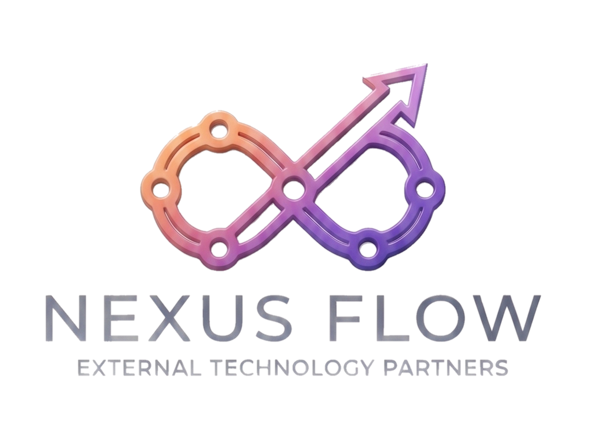
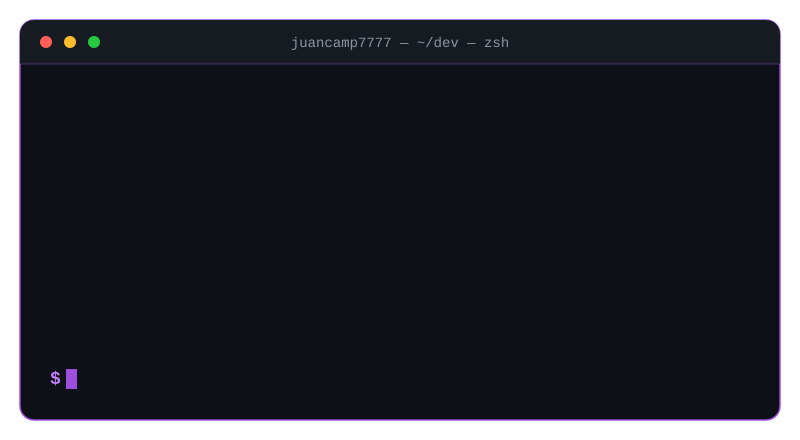

  

  

  
  
  
  

---

# Hi, I'm juancamp7777 👋
### Principal / Lead Software Engineer & Software Architect

With over 10 years of experience designing and evolving complex technological platforms, I specialize in building secure, high-performance, and scalable digital infrastructures. I am a **tech polyglot**, choosing the right tool for the job to ensure architectural excellence.

- 🏗️ **Architectural Expertise:** Clean Architecture, Microservices, DDD, Event-Driven, Modular Monoliths, and Hexagonal.
- 🔐 **Cybersecurity Focused:** Integrating security protocols (OAuth2, JWT, OWASP) from the ground up.
- 🚀 **Current Focus:** Leading international projects in TypeScript and developing decentralized protocols.

---

### 🛠️ Technical Arsenal

  
  
  
  
  
  
  
  
  

| Category | Technologies |
| :--- | :--- |
| **Languages** | TypeScript, Rust, Go, Python, Ruby, C++, Java, C#, SQL, Bash, JavaScript, Kotlin, PHP, Pascal, ADA /SPARK, Assembly (x86/x64). |
| **Architecture & Patterns** | Clean Architecture, Microservices, Modular Monoliths, DDD, Event-Driven, Hexagonal. |
| **Cybersecurity & Low-Level** | UEFI, Win32 API, Intel VT-x (Hypervisors), Halo's Gate (Syscalls), Applied Cryptography, JWT, OAuth2, OWASP. |
| **Backend & APIs** | Node.js (NestJS), FastAPI, Django, Flask, Spring Boot, gRPC, WebSockets, REST, GraphQL. |
| **Game Engines & Real-Time** | Unreal Engine, Godot, WebGL/Canvas, real-time state management, optimized rendering. |
| **Frontend & UI** | Next.js, React, Tailwind CSS, Angular, Vue.js, HTML5, CSS3, WebGL/Canvas (Gamification). |
| **Databases & BaaS** | PostgreSQL, MySQL, Supabase, Redis, MongoDB, Cassandra, Elasticsearch, DynamoDB. |
| **Cloud & DevOps** | **Docker**, Kubernetes, AWS, GCP, Azure, Terraform, CI/CD. |
| **Quality & Testing** | Jest, PyTest, JUnit, SOLID, TDD. |

---

### 🚀 Key Projects & Innovation

<b>🛡️ Type-1 Hypervisor & Security Research — Rust / UEFI</b>

 
Architected a custom bare-metal hypervisor leveraging Intel VT-x, Extended Page Tables (EPT) splitting, and VMX root mode for advanced system-level security research.

<b>🎯 Adversary Simulation Framework — Red Teaming</b>

 
Engineered a stealthy telemetry agent using indirect syscalls (Halo's Gate), dynamic XOR decryption, Domain Generation Algorithms (DGA) and memory-safe Rust to simulate Advanced Persistent Threats (APTs).

<b>🔐 Proprietary Cryptography & C2 Bridge — Go / Rust</b>

 
Implemented a secure Command & Control infrastructure with custom X25519/AES-256-GCM encryption, LSB steganography and asynchronous networking.

<b>🌑 Umbral Ecosystem — Decentralized Protocol</b>

 
Architected a decentralized, modular-monolith system from scratch, featuring a custom cryptographic security protocol to eliminate noise from traditional networks.

<b>🤖 Project Beast — AI & Telecommunications Hardening</b>

 
Led critical architecture work on "RoboBeast": resolved LLM hallucinations, optimized conversational AI flow, and engineered a zero-token-cost deterministic Circuit Breaker with robust state management in LangGraph.

<b>🎮 Interactive Brand Gamification</b>

 
Built a custom interactive video game for a brewery brand with real-time state management and optimized rendering.

<b>📈 MarketPredator — AI Algorithm</b>

 
Designed the backend infrastructure for an AI-driven client-prospecting algorithm with global data extraction and analysis.

---

### 📊 Metrics & Activity

  

  

  

---

### 📫 Connect with me

* **Location:** Boyacá, Colombia | Remote International
* **Email:** nexusflowjuandev@proton.me
* **Philosophy:** "Those who know me already know what to expect; those who don't, I'll just say that I'm passionate about what I do."

---

### 🏗️ Highlighted Architecture & Confidentiality

*Note: As a Principal Engineer and Architect specializing in low-level systems and cybersecurity, my most complex, enterprise-grade work (including Type-1 hypervisors, proprietary C2 infrastructures, and high-performance algorithms) is strictly confidential. The public repositories here represent only a fraction of my professional and architectural scope.*

  

